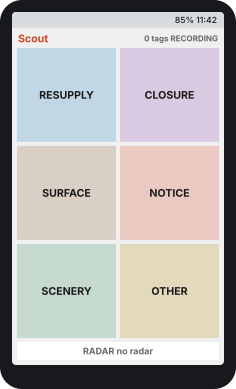
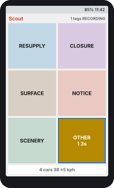
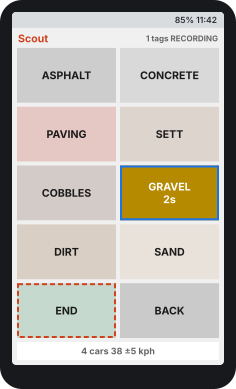
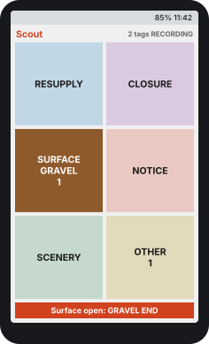

<!-- SPDX-License-Identifier: CC-BY-SA-4.0 -->

# Scout for Karoo: user manual

Install, set up, and tag your rides on a Hammerhead Karoo.

Scout lets you tag what you see on a ride (resupply stops, closures, road
surface, hazards, scenery) with a tap on your Karoo. The tags, and readings
from a rear radar if you have one, are saved inside your ride's normal `.fit`
file. Scout has no account and uploads nothing. What Scout is for, and how a
tag reaches the map, is on [Scout: tagging while you ride](scout.md).

!!! info "Beta tester?"

    Thank you! Install from the **beta** link in
    [Install Scout](#2-install-scout), set up the page, then do the test rides
    in [Beta testing](#10-beta-testing) and send us what it asks for.

## 1. What you need

- A **Hammerhead Karoo 2 or Karoo 3** with its latest software update
  installed. Scout is a Karoo extension, which needs recent Karoo software.
- On a Karoo 3: a phone with the **Hammerhead Companion** app. On a Karoo 2:
  a computer with ADB and the Scout APK from the
  [Scout releases page](https://github.com/cycling-commons/scout/releases)
  (the releases named **Scout for Karoo**).
- Optional: a **rear radar** (Garmin Varia or similar ANT+ radar).

## 2. Install Scout

???+ note "Karoo 3: with the Hammerhead Companion app"

    1. On your phone, long-press the install link, then **Share** it. The
       Companion app installs from a link, not from a downloaded file.

        - [Regular releases](https://github.com/cycling-commons/scout/releases/download/karoo/stable/manifest.json):
          `https://github.com/cycling-commons/scout/releases/download/karoo/stable/manifest.json`{ .cc-url }
        - [Beta testers](https://github.com/cycling-commons/scout/releases/download/karoo/beta/manifest.json),
          also getting test builds:
          `https://github.com/cycling-commons/scout/releases/download/karoo/beta/manifest.json`{ .cc-url }

        The link always points to the newest version of its kind, and a Karoo
        installed from it offers later versions as updates. Installed an earlier
        beta from an APK link? Install once more from the link to get updates.

    2. Choose **Hammerhead Companion** as the share target.
    3. On the Karoo, accept the prompt and tap **Install**.

    Hammerhead's guide:
    [Companion App Sideloading](https://support.hammerhead.io/hc/en-us/articles/31576497036827-Companion-App-Sideloading).

??? note "Karoo 2 (or Karoo 3 over USB): with ADB on a computer"

    1. Download the APK to your computer.
    2. Turn on USB debugging on the Karoo and connect it with a USB cable.
    3. Run `adb install -r scout-karoo-<version>.apk` in the folder with the APK.

Afterwards **Scout** appears in the Karoo app list. Opening it shows the ride
state, an **Open tagging** button and a short setup reminder.

## 3. Set up the Scout page

You do this once per ride profile you want to tag with.

1. On the Karoo, open the ride profile you'll use and **add a data page**.
2. Pick the layout with **a single field**.
3. Set that field to **Scout** (it's listed with the extension fields).
4. Save the profile.

!!! warning "The Scout field must be on your ride profile"

    That is what switches Scout on for the ride. Without it Scout records
    nothing. You don't need to keep the page on screen: Scout keeps recording
    while you look at other pages.

### Field size

Karoo lets you choose how much of a page each field gets. Scout adapts to the
space you give it:

| Scout's share of the page | What it shows |
|---|---|
| **Whole page** (recommended) | The tag tiles. Tap them right on the page. |
| Half a page or more | The same tiles, smaller. Fine for the six main tiles; the ten surface choices get tight. |
| Less than half | Status only: ride state, tag count, radar. Tap it to open the full-screen tag screen. |

### Optional extras

- **Tag ride button.** In your controller or button settings, assign the bonus
  action **Tag ride** to a button. It opens a full-screen copy of the tiles
  from any page. The Scout app's **Open tagging** button does the same.
- **Radar.** Pair it as usual in Karoo **Settings → Sensors**. Scout has no
  pairing screen of its own.

## 4. Riding with Scout

Start, pause and end the ride on the Karoo as usual. Scout follows along by
itself; there is no separate start button. Swipe to the Scout page whenever
you want to tag something.

<figure markdown>

<figcaption markdown>**Ride started.** The six main tiles, the ride's tag total, and the radar strip.</figcaption>
</figure>
<figure markdown>

<figcaption markdown>**Tap OTHER.** The tile fills in and counts down; tap again before it ends to undo.</figcaption>
</figure>
<figure markdown>

<figcaption markdown>**Tap SURFACE, pick GRAVEL.** The choice saves when its countdown ends. Gravel stays open until you end it: tap END (dashed) where the gravel stops.</figcaption>
</figure>
<figure markdown>

<figcaption markdown>**Gravel stretch open.** Where the gravel stops, tap the red END strip (or SURFACE, then END).</figcaption>
</figure>

### The basics

- **One tap tags.** The tile lights up, the Karoo beeps, and the tag is written
  at the current second of your ride.
- **Choices.** Most tiles open a set of follow-up choices. Tap one; it saves
  after a 3-second countdown. Tap a different choice during the countdown to
  change it. **BACK** returns to the main tiles without a tag.
- **No choice made?** After 12 seconds the choices close. Closure, Notice,
  Surface and Scenery still save a tag without the detail; Resupply saves
  nothing.
- **Undo.** After tapping OTHER, the tile counts down for 3 seconds; tap it
  again in that time to undo the tag. You hear a different, two-tone beep. For
  tiles with choices, fix a wrong pick during its countdown instead.
- **Counts.** The number on a tile is how often you've used it this ride; the
  top right shows the ride's total.
- **Only while recording.** Before the ride starts or while it's paused, the
  top right says so and taps do nothing.

### Surface stretches

A surface tag starts a stretch: from here on the road is, say, gravel. While a
stretch is open, the SURFACE tile stays lit with the surface name and a red
**Surface open: … END** strip shows at the bottom. **A stretch stays open until
you end it**: where the surface stops, tap the red strip, or tap SURFACE and
then **END**. Picking a different surface instead closes the old stretch and
starts a new one.

## 5. Tile reference

| Tile | Choices | Use it for |
|---|---|---|
| **RESUPPLY** | Water · Food · Repair | Places to refill, eat or fix your bike |
| **CLOSURE** | Today · Days · Weeks · Months · Unknown | A closed road or path, and roughly how long it looks closed |
| **SURFACE** | Asphalt · Concrete · Paving · Sett · Cobbles · Gravel · Dirt · Sand · End | Where the road surface changes |
| **NOTICE** | Potholes · Crossing · Corner · Other | Hazards worth warning other riders about |
| **SCENERY** | Nature · History · Culture · View · Architecture · Unknown | Places worth a stop or a photo |
| **OTHER** | None: tags straight away | Anything else; add a note after the ride |

## 6. Radar

With a paired radar, the bottom strip of the Scout page shows how many cars
have passed you this ride and an estimate of the last car's speed. Without one
it reads *no radar*, or *Connecting…* while the Karoo looks for the radar.
Radar readings are saved with your ride every second, whether or not you tag
anything.

Karoo doesn't share the radar's own car speeds with apps, so the speed on
screen is Scout's estimate from how quickly the gap closes, and the speed in
the file is left empty.

## 7. Your data

Everything Scout records goes into the ride's normal `.fit` file, so it travels
wherever your rides already go: the Hammerhead dashboard, Strava, or a USB
copy. Each recorded second gets five extra values:

| Field | Meaning |
|---|---|
| `poi_type` | What you tagged that second (0 = nothing) |
| `poi_detail` | The choice you picked, e.g. which surface |
| `radar_count` | Cars the radar sees behind you |
| `radar_near` | Distance to the nearest car |
| `radar_speed` | Always 255 (unknown) on Karoo |

To look at them, open `fit-viewer.html` (in the release download) in a browser
on your computer and load a ride file.

## 8. Troubleshooting

| What you see | What to do |
|---|---|
| "Start a ride on Karoo before tagging" while riding | Check the ride is actually recording, not paused or not yet started. |
| Scout page shows status text instead of tiles | The field is less than half a page. Give it a page of its own (see [Set up the Scout page](#3-set-up-the-scout-page)). |
| Tapping a tile does nothing | Make sure the ride is recording. If it still doesn't respond, use the **Tag ride** button or the Scout app's **Open tagging** screen, and let us know your Karoo model and OS version. |
| No beep on a tag | Check the Karoo's sound settings. The tile lighting up still confirms the tag. |
| Radar stays on *no radar* | Pair the radar in Karoo Settings → Sensors and check it's switched on and connected. |
| No Scout values in the ride file | The Scout field wasn't on the ride profile you used, or the ride never started recording. |

Report problems on the
[Scout issue tracker](https://github.com/cycling-commons/scout/issues). Your
Karoo model, OS version, a photo of the screen and the ride's `.fit` file help
most.

## 9. Update or remove

- **Update:** if you installed with the Companion install link, the Karoo
  offers new versions by itself; accept the update when it appears. If you
  installed from an APK link or with ADB, install the newer APK the same way,
  or switch to the install link once. Your profile pages stay as they are.
- **Remove:** uninstall Scout from the Karoo's app settings, then delete the
  Scout page from your ride profiles.

## 10. Beta testing

!!! warning "This is an early test on a real Karoo"

    Things may break, and that's exactly what we want to find out. A crash or
    something odd is a useful result. Just note what you were doing when it
    happened.

Install from the beta link ([section 2](#2-install-scout)) and give the Scout
field **a page of its own** ([section 3](#3-set-up-the-scout-page)), so it
shows the tag tiles. Each test ride takes about 15 minutes. Start and stop the
ride on the Karoo as usual.

### Ride A: recording without tagging

1. Start a ride. For the first few minutes, stay on a page **without** the
   Scout field.
2. If you have a radar, ride somewhere cars pass you.
3. Swipe to the Scout page and check that it shows **RECORDING**, a tag count,
   and a radar line (e.g. *no radar* or *3 cars*).
4. End and save the ride.

### Ride B: tagging

1. Start a ride and swipe to the Scout page.
2. **Tap a few tiles.** Does the tile light up and the count go up? If tapping
   does nothing, use the **Tag ride** bonus action or the Scout app's
   **Open tagging** instead, and tell us.
3. **Beeps:** do you hear a beep on every tag? Try once with the Karoo's sounds
   turned off too, and tell us whether it still beeps.
4. **Choices:** tap NOTICE, pick an option, then **swipe to another page
   straight away**. The tag should still be saved (the count goes up).
5. **Undo:** tap OTHER, then tap it again within 3 seconds. You should hear a
   different, two-tone beep and the count goes back down.
6. **Surface:** tap SURFACE and pick one. Ride a bit, then end the stretch with
   the red **END** strip at the bottom.
7. Go back to your normal pages, ride a bit, end the ride.

### Ride C: radar car count (if you have a radar)

1. Ride a road with some traffic and roughly **count the cars that overtake
   you**.
2. At the end, compare your count with the *cars* number on the Scout page.

### What to send back

- **Karoo model** (2 or 3), **Karoo software version** (shown in the Karoo
  settings) and the **Scout version** (in the Karoo app list).
- Ride B: did taps on the Scout page work, and did it beep with sounds on and
  with sounds off?
- For each ride: radar yes/no, roughly how many tags you made, and, for
  Ride C, your car count and Scout's.
- **The ride `.fit` files.** Get them from the Hammerhead dashboard (export
  activity), a service you sync to, or over USB.
- Anything odd: crashes, a Scout page that says to start a ride while you're
  riding, missing beeps, a frozen screen. Photos of the Karoo screen help a
  lot.
